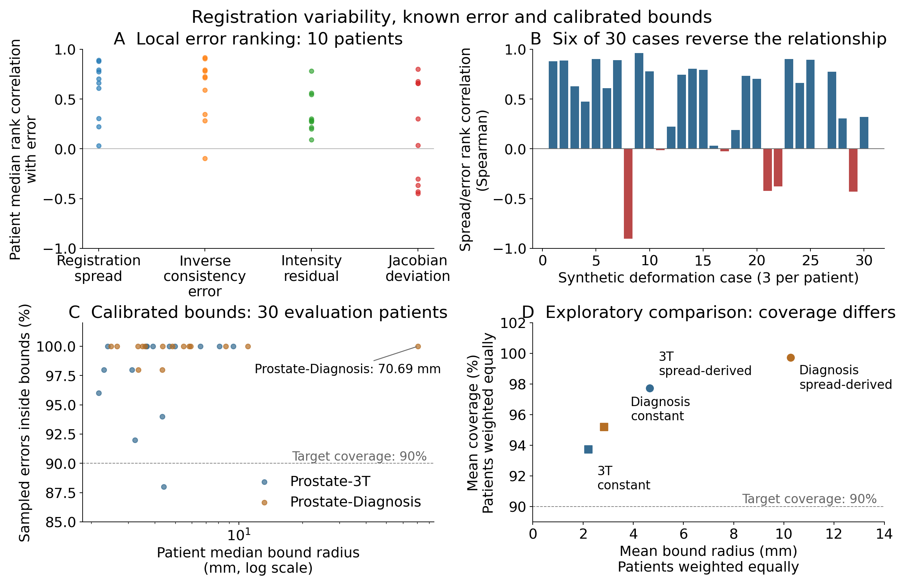

# TrueMargin

Experiments on whether disagreement between different image alignments reveals where those alignments are wrong. Image registration aligns scans so corresponding structures can be compared.

**Question:** does variation between registrations help identify local alignment error?

The controlled studies are complete. External landmark validation was not completed. This is research software, not a clinical product.

[Technical report](docs/technical_report.md) · [Reproduction](docs/reproduction.md) · [Study records](research/README.md)



## Findings

The variation between repeated alignments is called **ensemble spread**. **Inverse-consistency error** checks whether aligning forward and then backward returns to the starting location. Spearman correlation measures whether larger signal values tend to accompany larger known errors; it is not a percentage accuracy.

A nine-setting registration ensemble was evaluated on 30 synthetic-deformation cases across 10 anatomies. Results were summarized by anatomy rather than treating all 1,500 sampled locations as independent subjects.

| Signal | Median anatomy-level Spearman correlation with known error |
| --- | ---: |
| Ensemble spread | 0.6841 |
| Inverse-consistency error | 0.7203 |
| Image residual | 0.2851 |
| Jacobian deviation | 0.1689 |

Spread contained useful information, but did not show an advantage over inverse-consistency error. Six case-level correlations were negative. There were 39 high-error, low-spread observations across 11 cases and seven anatomies.

Calibration uses separate examples to set an error-bound radius. Coverage is the fraction of sampled errors within that radius; high coverage can still require an unhelpfully large radius. A separate study used 30 calibration and 30 evaluation anatomies. At nominal 90% coverage, observed mean anatomy-level coverage was 97.73% and 99.73% for the two sources, with median anatomy radii of 3.93 mm and 4.36 mm. One anatomy had a 70.69 mm median radius. The bounds were conservative, and the 95% thresholds were infinite under the finite-sample construction. Reverse-registration failures prevented the full-cohort calibrated comparison with inverse-consistency error.

A later calibration-only analysis found source-dependent effects, not a consistent improvement. These controlled results do not establish clinical validity or external generalization.

## Check the saved results

From a checkout with Python 3.12:

```bash
python scripts/verify_m6_phase_a_result.py results/m6_phase_a
python scripts/verify_m6_phase_b_result.py results/m6_phase_b
```

These commands check the saved results without downloading images or rerunning registrations.

## Development

Use Python 3.12 and a Git checkout. The full test suite requires the imaging dependencies as well as the development tools. First install the OpenSlide system library using the [platform setup instructions](docs/reproduction.md), then run:

```bash
python -m pip install -e ".[realdata,dev]"
pytest
```

This matches the dependency groups used by CI. Full experiments also require the source data described in the reproduction guide.

## Detailed results

- [Known-error study and comparators](docs/hyperparameter_known_gt_result.md)
- [Failure analysis](docs/m5_informativeness_characterization.md)
- [Calibration results](docs/m6_phase_b_evaluation_result.md) and [failure diagnostics](docs/m6_failure_diagnostics.md)
- [Calibration-only analysis](docs/m6_calibration_only_scale_validation.md)
- [Saved results](results/README.md)

## External study

A lung-CT protocol and initial image checks were prepared. Two saved Case7 displacement fields were almost identical after a tolerance change, and both runs reached the iteration limit. These checks did not establish convergence or alignment accuracy. Numerical landmarks remain unopened.

The [protocol](docs/external_lung_validation_protocol.md) and [study status](research/STATE.md) document where this work stopped. No external landmark results are available.

## Code and licensing

Analysis code is in `src/`; experiment scripts are in `scripts/`; numerical tests are in `tests/`. Methods and study records are linked above.

Original project software and associated documentation are available under the [MIT License](LICENSE). Third-party datasets, model weights, software and other materials retain their own licences and attribution requirements; the MIT licence does not relicense them.
